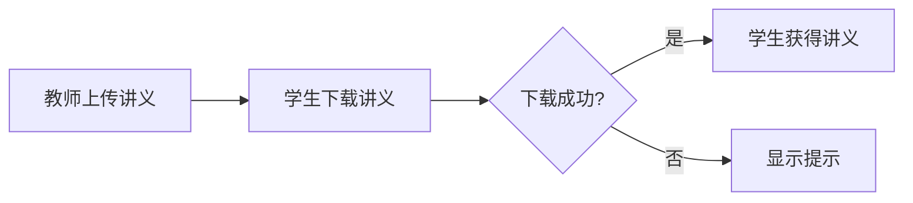
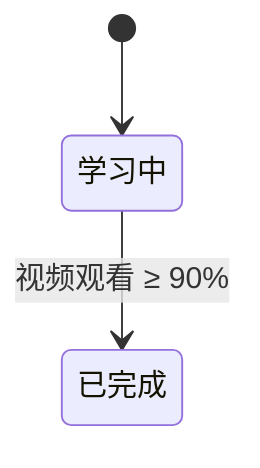
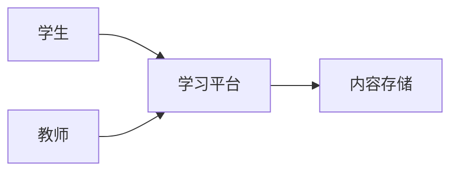
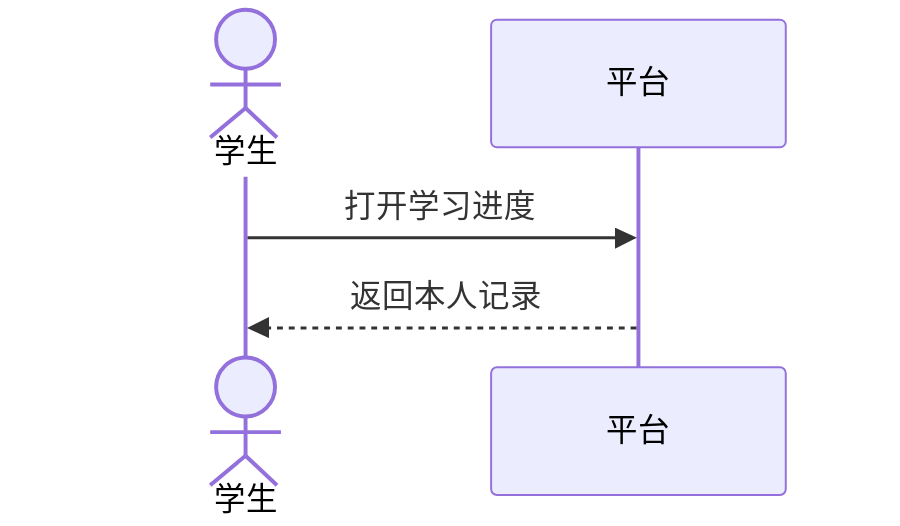
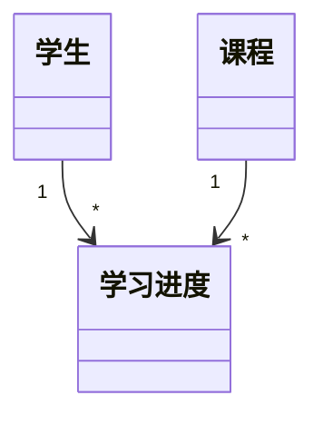

# 建模指南

## 1. 建模的目的

建模是用一张图回答一个具体问题，不是把需求画全。每张图先写清：**它回答什么问题。**

本文件中的编号、示例和示例内容均为通用示例，不对应本项目；示例编号只用于说明，不占用项目 `07-dialogue.md` 的编号。

### 需求模型与设计模型

| 需求阶段可以画 | 设计阶段才画 |
|---|---|
| 上下文图、用例图、活动图、状态图、领域类图、决策表、用户旅程图 | 架构图、组件图、部署图、数据库表结构、内部服务时序图、算法流程图 |

- 需求模型回答：谁、做什么、什么状态、什么规则、概念之间什么关系。
- 设计模型回答：怎么实现。
- 图上的每个元素必须有来源：`S/D/REQ`。
- **未回答的 Q 不能作为图元素来源**；Q 只是问题，不是答案。
- `P` 可以帮助提问，但不能直接作为图元素来源；由 P 引出的内容先转成 Q，回答后再画。
- 没有来源的元素写 Q，不画；设计内容进 `DSN-`，不进需求图。

## 2. 三种核心图

### 2.1 活动图：事情按什么顺序发生

回答：流程有哪些步骤、分支、异常。

用 Mermaid `flowchart`。

示例（S-001：教师上传讲义后，学生能下载；下载失败给出提示）：



只画原话支持的步骤。登录、权限、文件类型、提示内容、重试没有来源，不画，写 Q。

### 2.2 状态图：对象有哪些状态、怎么变化

回答：一个对象从产生到结束经历哪些状态，迁移条件是什么。

用 Mermaid `stateDiagram-v2`。

示例（前提：Q-007 已回答“视频观看达到 90% 算完成”）：



如果 Q-007 还没回答，就**不能画“已完成”**；状态名和迁移条件都没有来源。正确动作是先提问，不画图。

### 2.3 决策表：多条规则组合的结果

回答：不同条件组合分别导致什么结果。

用 Markdown 表。示例（前提：Q-007 已回答“视频 ≥ 90% 或教师手动确认都算完成”）：

| 视频观看 ≥ 90% | 教师手动确认 | 结果 |
|---|---|---|
| 是 | 任意 | 完成 |
| 否 | 是 | 完成 |
| 否 | 否 | 未完成 |

每个条件都必须有来源；“作业是否提交”如果还没问，不能加列，写 Q。

## 3. 其他图什么时候用

| 图 | 回答什么问题 | 注意 |
|---|---|---|
| 上下文图 | 系统边界在哪？有哪些外部角色和系统？ | 只画已确认的外部角色/系统 |
| 用例图 | 有哪些角色？各自能做什么？ | Mermaid 无原生用例图，用 `flowchart` 近似 |
| 时序图 | 角色、平台、外部系统/智能体如何交互？ | 只画角色与系统/外部系统，不画内部服务 |
| 领域类图 | 核心概念及关系是什么？ | 不是数据库表结构；不画字段类型 |
| 用户旅程图 | 用户从进入到结束经历哪些阶段？哪里痛？ | 用于梳理和讨论，不用于验收 |

Mermaid 示例：







## 4. 完整示例：学生下载讲义

### 4.1 先写问题

> 学生下载讲义的正常流程和失败分支是什么？

### 4.2 列元素和来源

| 元素 | 来源 |
|---|---|
| 教师 | S-001 |
| 上传讲义 | S-001 |
| 学生 | S-001 |
| 下载讲义 | S-001 |
| 下载失败 | S-001 |
| 显示提示 | S-001 |
| 登录、权限、文件类型、提示内容、重试 | 无来源，待 Q |

### 4.3 选图型

问题是“流程和分支”，选活动图。

### 4.4 只画有来源的元素


### 4.5 标出缺口

> 未画：登录、权限、文件类型、提示内容、重试。对应待登记的 Q；示例编号不占用项目 Q 编号。
> 本图只表达 S-001 已确认的行为。

### 4.6 保存

文件：`docs/requirements/models/platform-handout-download.mmd`

```mermaid
%% 问题：学生下载讲义的正常流程和失败分支
%% 来源：S-001
%% 状态：候选，待评审
```

## 5. 画图检查表

- [ ] 图回答了明确的问题
- [ ] 每个框、箭头、判断条件都有来源（`S/D/REQ`）
- [ ] 没有把未回答的 Q、`P` 或 `I` 当作图元素来源
- [ ] 没有设计内容（内部服务、数据库、算法、框架）
- [ ] 没有新增原话没有的角色、字段、状态、规则
- [ ] 术语与 `glossary.md` 一致
- [ ] 缺口已写成 Q
- [ ] 文件头有问题、来源、状态
- [ ] 一图一文件，文件名与图题一致

## 6. 什么时候建模、在流程中的位置

### 6.1 触发条件

| 触发信号 | 用哪种图 | 例子 |
|---|---|---|
| 流程有 3 步以上，或有 2 个以上分支/异常 | 活动图 | 学生下载讲义：成功/失败 |
| 对象有 3 个以上状态或迁移 | 状态图 | 学习进度：学习中→已完成→归档 |
| 3 个以上条件组合决定结果 | 决策表 | 完成规则：视频 90%、教师确认 |
| 3 个以上角色/外部系统交互 | 时序图 | 预警→教师→学生 |
| 系统边界或外部系统不清楚 | 上下文图 | 平台与内容存储、AI 服务 |
| 角色能力范围不清楚 | 用例图 | 学生/教师/管理员分别能做什么 |
| 3 个以上核心概念关系不清楚 | 领域类图 | 学生、课程、学习进度 |
| 用户说“这个流程有点绕/说不清” | 对应图 | 先问清问题，再选图 |
| 验收标准有 3 个以上 Given-When-Then 场景 | 活动图/状态图/决策表 | 多分支需求 |
| 评审“完整”不通过，缺分支、状态或规则 | 对应图 | 评审发现遗漏 |
| 冲突检查发现状态、权限、生命周期冲突 | 状态图/决策表 | 删除 vs 保留 |
| 多阶段流程或实时状态模型需要阶段、状态或交互 | 状态图/时序图 | 阶段流程、状态更新 |
| 用户明确要求，或汇报需要 | 从已确认内容中挑图 | 不补图 |

AI 提议建模时，要说明“哪个问题文字说不清、建议用哪种图”；由用户确认后再画。

### 6.2 不建模的场景

- 单一角色、单一动作、单一结果：故事卡和验收标准就够了
- 来源不足或 Q 未回答：先提问，不画
- 设计、架构、数据库、算法、内部服务：进 `DSN-`，不进需求图
- 图只是复述故事卡，没有回答新问题
- 只为装饰 PPT，没有读者或评审用途
- 画出来会引入原话没有的角色、状态、规则

反例：“学生可以查看自己的学习进度”如果只有一句话、没有分支、没有状态、没有多角色，不需要画图；画活动图只是把同一句话重画一遍。

### 6.3 在流程中的位置

- 模块进入：边界或角色不清时，考虑上下文图/用例图
- 故事卡成形后、评审前：最常用的时机
- 冲突检查：状态、权限、生命周期有冲突时，考虑状态图/决策表
- 变更：变更影响流程或状态时，更新或新增图
- 交接设计前：需要团队对流程/状态有共同理解时
- 图是需求的视图，不是新的需求来源
- 画图发现缺口 → 写 Q；发现设计 → 写 `DSN-`
- 另一名成员评审时检查：元素是否有来源、是否混入设计
- 追踪矩阵的“模型”列填写图文件路径或图名

### 6.4 AI 的具体动作

1. 说明为什么需要图：哪个问题文字说不清
2. 提出最小图型，并说明选择理由
3. 检查来源：每个元素必须有 `S/D/REQ`；缺口写 Q
4. 只画有来源的部分；未回答的 Q、`P`、`I` 不作来源
5. 保存到 `models/<模块>-<主题>.mmd`，文件头写问题、来源、状态
6. 由另一名成员评审元素来源和设计隔离

## 7. 常见错误

- 为了“完整”把所有图都画一遍
- 图上出现没有来源的角色、字段、状态
- 把未回答的 Q 当成答案画进图里
- 把数据库表、内部服务、算法画进需求图
- 同一概念在不同图里不同名
- 用图代替验收标准
- 为 PPT 补图，而不是从已确认内容里画图
